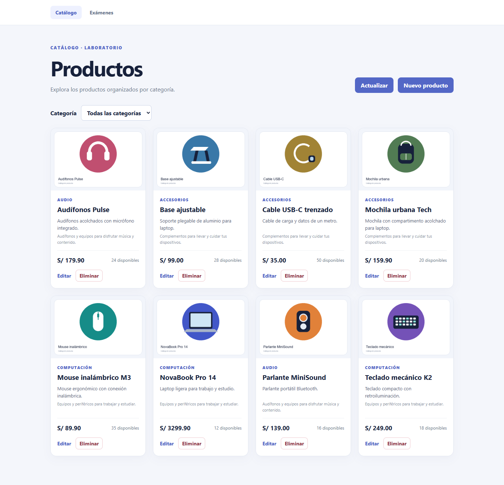
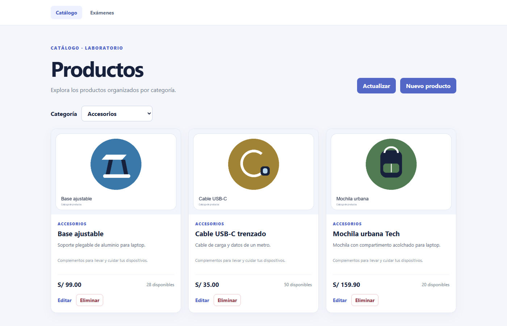

# Laboratorio 13 — Catálogo de comercio electrónico

**Curso:** Desarrollo de Aplicaciones Empresariales · 4-C24-A  
**Docente:** Michael Montgomery Rosell  
**Nombre del alumno:** ____________________  

## Desarrollo de los pasos 7 a 10

| Paso | Desarrollo | Código |
|---|---|---|
| 7 | El catálogo carga los productos en un efecto. Muestra imagen, precio, categoría y existencias. Presenta estados de carga, error con reintento y resultados. | [CatalogPage.jsx](../frontend/src/components/CatalogPage.jsx) |
| 8 | El selector consulta las categorías de Django y filtra por el identificador de la categoría anidada. Los servicios recorren todas las páginas de la API. | [CatalogPage.jsx](../frontend/src/components/CatalogPage.jsx), [categoryService.js](../frontend/src/services/categoryService.js) |
| 9 | El formulario controlado obtiene las categorías por servicio. Envía nombre, descripción, precio, existencias, categoría e imagen. Tras guardar, vuelve al catálogo. | [ProductFormPage.jsx](../frontend/src/components/ProductFormPage.jsx) |
| 10 | El mismo formulario carga y modifica un producto. Si se mantiene la imagen, el archivo se omite del PATCH. El catálogo vuelve a consultar los datos al guardar y retira del estado el producto borrado cuando la API confirma. | [ProductFormPage.jsx](../frontend/src/components/ProductFormPage.jsx), [CatalogPage.jsx](../frontend/src/components/CatalogPage.jsx), [productService.js](../frontend/src/services/productService.js) |

Django gestiona los datos y devuelve la categoría dentro de cada producto. React carga y modifica esos datos a través de los servicios, con una sola configuración del cliente Axios. Las instrucciones para iniciar ambos proyectos están en el [README](../README.md).

## Diagrama del catálogo

~~~mermaid
erDiagram
    CATEGORY ||--o{ PRODUCT : agrupa
    CATEGORY {
        integer id PK
        string name
        text description
    }
    PRODUCT {
        integer id PK
        integer category_id FK
        string name
        text description
        decimal price
        integer stock
        image image
    }
~~~

## API del catálogo

| Ruta | Métodos | Comportamiento |
|---|---|---|
| /api/categories/ | GET, POST | Lista paginada y alta de categorías. |
| /api/categories/{id}/ | GET, PUT, PATCH, DELETE | Consulta, modificación y borrado de una categoría. Django protege las categorías asociadas a productos. |
| /api/products/ | GET, POST | Lista paginada con categoría anidada y alta con multipart. |
| /api/products/{id}/ | GET, PUT, PATCH, DELETE | Consulta, modificación y borrado de un producto. |

Las respuestas de productos incluyen el objeto category con id, name y description. Las escrituras reciben category_id. La imagen es obligatoria en el alta y opcional para una edición parcial.

## Casos de prueba

| Caso | Resultado esperado |
|---|---|
| Abrir el catálogo con los datos de la migración | Aparecen ocho productos con imagen, precio y categoría. |
| Seleccionar una categoría | Solo aparecen productos asociados a la categoría. |
| Registrar un producto con una imagen válida | El navegador vuelve al catálogo y aparece el nuevo producto. |
| Editar el precio sin cargar otra imagen | El catálogo muestra el nuevo precio y conserva la imagen. |
| Eliminar el producto de prueba y confirmar | El producto desaparece del catálogo sin recargar la página. |

## Evidencia visual

Las cinco pruebas de la tabla se ejecutaron en Edge con Django y React activos y una base SQLite de prueba.

## Estructura del proyecto

~~~text
Semana8/
├── catalog/                    Modelos, serializadores, vistas y rutas
├── config/                     Configuración y enrutador principal
├── frontend/
│   └── src/
│       ├── App.jsx             Navegación del catálogo y exámenes
│       ├── components/
│       │   ├── CatalogPage.jsx
│       │   └── ProductFormPage.jsx
│       ├── services/
│       │   ├── apiClient.js
│       │   ├── categoryService.js
│       │   ├── loadAllPages.js
│       │   └── productService.js
│       └── styles/
├── media/products/
└── docs/
~~~

## Conclusión

La categoría anidada permite mostrar su nombre y descripción con la respuesta de productos. La consulta independiente de categorías alimenta los selectores de filtro y de formulario, incluso cuando existen categorías sin productos asociados.

